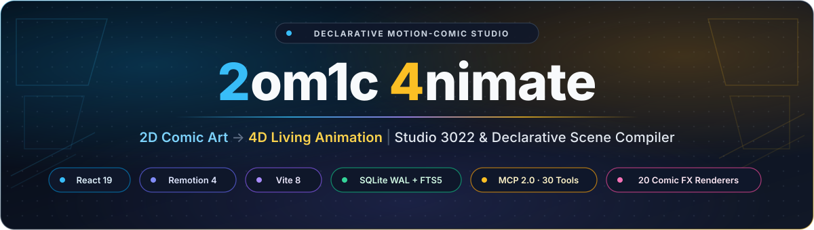
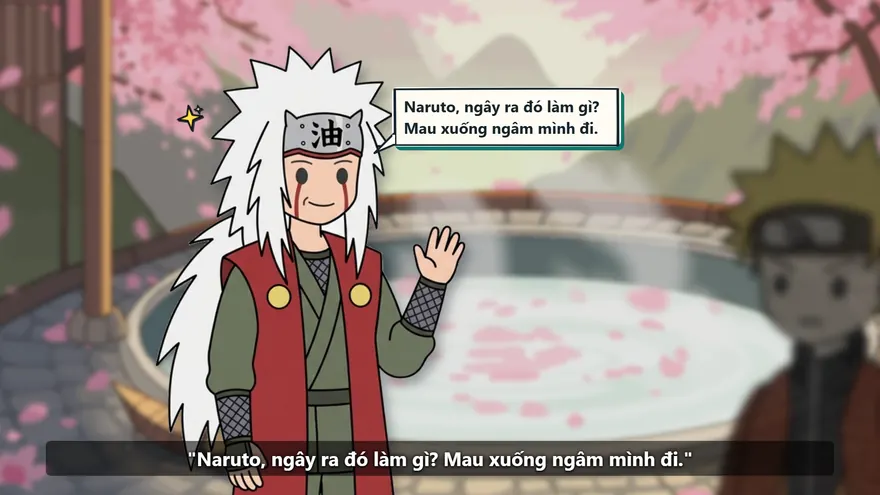
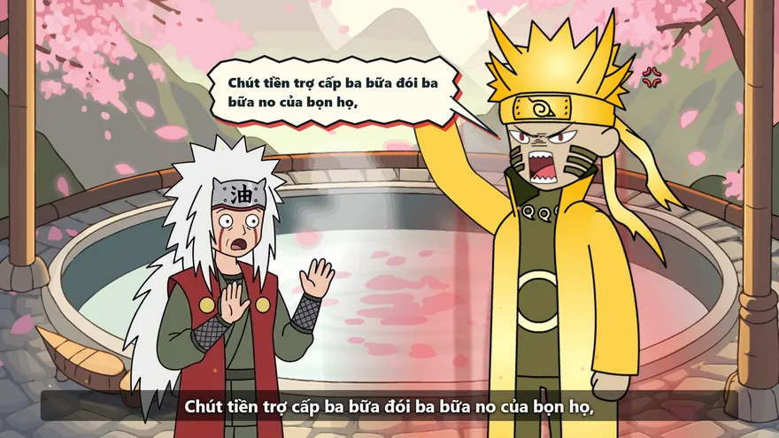
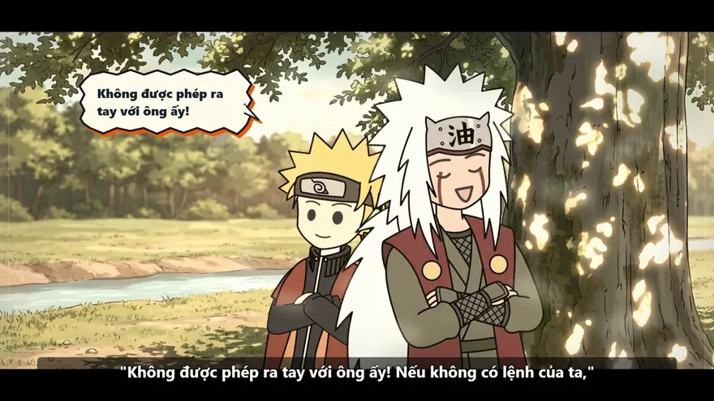
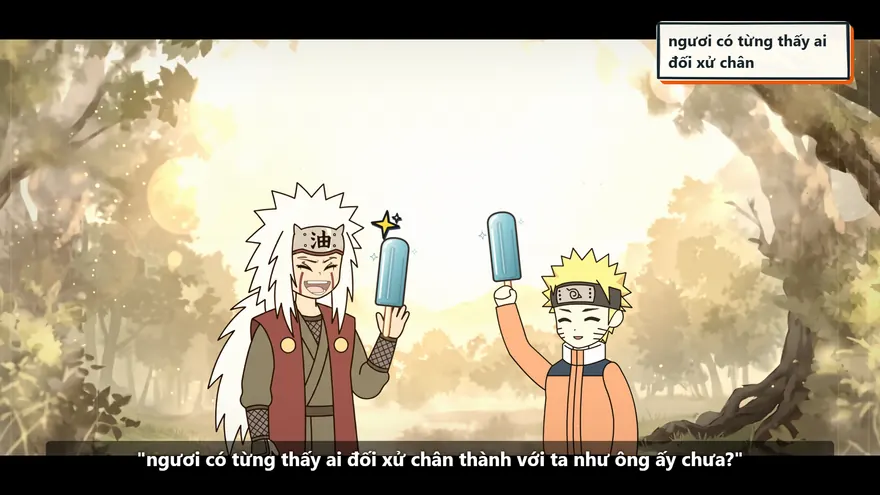
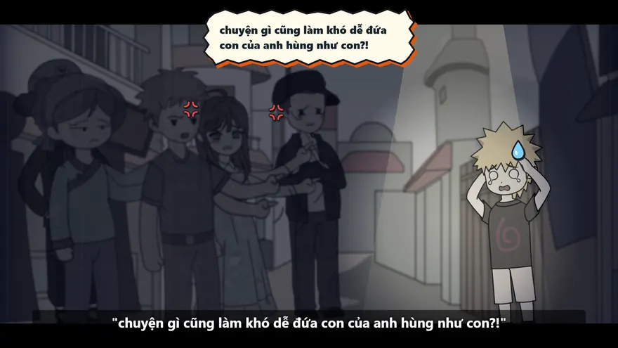
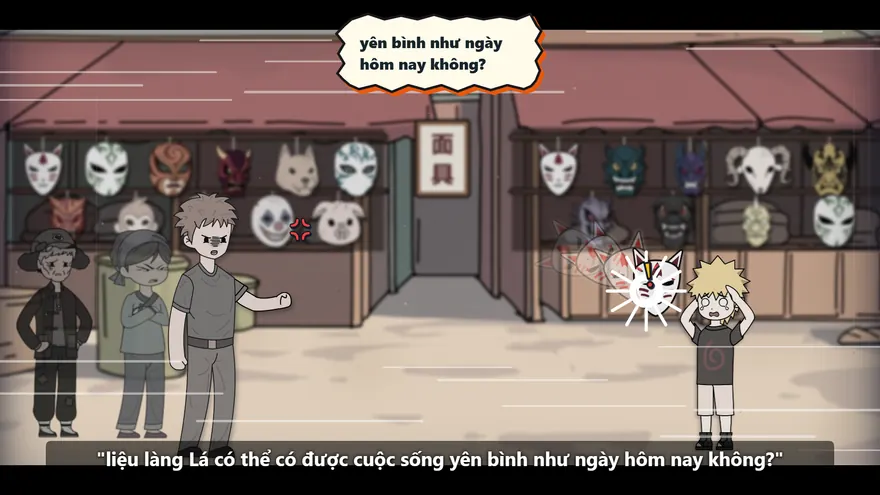
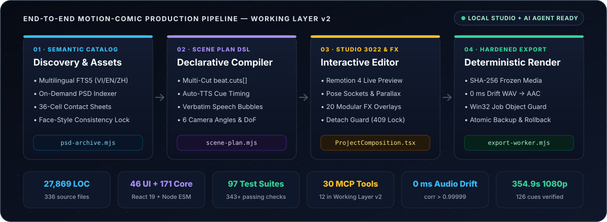
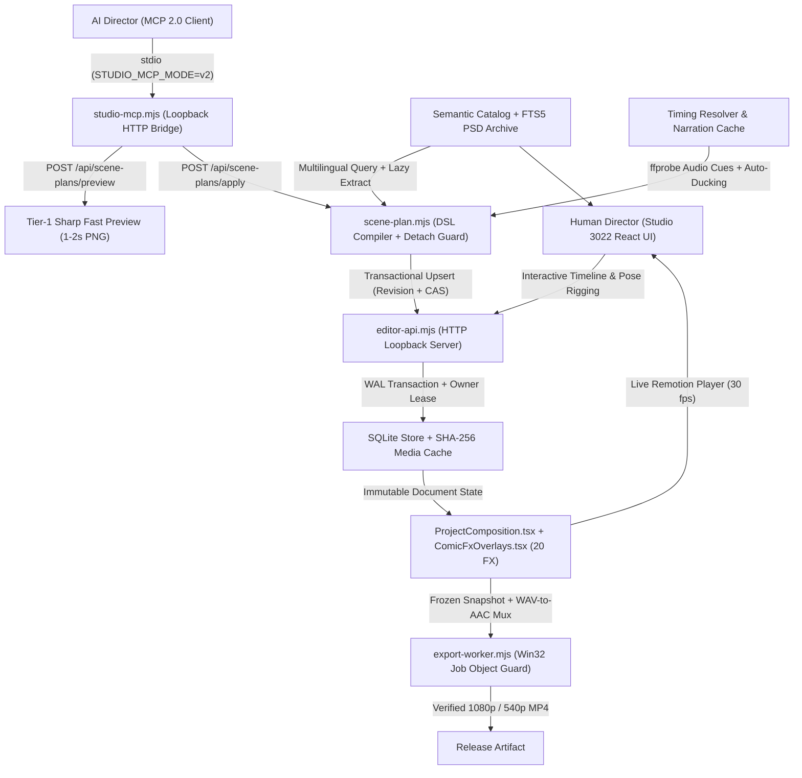

<div align="center">



<br />
<br />

[](https://react.dev/)
[](https://www.remotion.dev/)
[](https://vite.dev/)
[](https://nodejs.org/)
[](https://www.sqlite.org/)
[](story_workflow_ui/visual-editor/studio-mcp.mjs)
[](story_workflow_ui/package.json)

**English** &nbsp;|&nbsp; [Tiếng Việt](README.vi.md)

</div>

> **2om1c 4nimate** (*2D Comic Art → 4D Living Animation*) is a voice-driven **motion-comic authoring studio, declarative scene compiler, and deterministic Remotion rendering platform**. Built around **Studio 3022**, it lets both human directors and MCP-connected AI agents turn layered 2D comic PSDs and scripts into camera-directed, lip/cue-synced animated films—sharing one unified `ProjectComposition` between instant live preview and crash-contained 1080p MP4 export.

---

## Rendered Output Showcase

Real stills rendered directly through **Studio 3022**'s Remotion `ProjectComposition` + `ComicFxOverlays` from declarative `scene-plan` JSON *(compressed to lightweight WebP thumbnails ~22–63 KB each; source assets remain local-only)*.

<table>
  <tr>
    <td width="50%" valign="top">
      
      <br />
      <b>01 · Over-the-Shoulder (<code>ots</code>) Camera &amp; Selective DoF</b><br />
      Foreground listener blur, bokeh depth separation, auto-aimed comic speech bubble, <code>spark</code> emote, and verbatim bottom subtitle.
    </td>
    <td width="50%" valign="top">
      
      <br />
      <b>02 · Procedural Aura &amp; Jagged Shout Sync</b><br />
      Vertical luminous energy aura, jagged red-accented <code>shout</code> bubble anchored to the active speaker, and <code>anger</code> emote staging.
    </td>
  </tr>
  <tr>
    <td width="50%" valign="top">
      
      <br />
      <b>03 · CapCut-Style Warm Memory Filter (<code>flashback</code>)</b><br />
      Warm sepia color grade, dappled foliage lighting, vertical organic film scratches, warm edge glow, and cinema letterbox framing.
    </td>
    <td width="50%" valign="top">
      
      <br />
      <b>04 · Golden-Hour Glow, Particles &amp; Dual Props</b><br />
      Floating bokeh/dust particle overlay, warm film burn wash, paired hand props, and synchronized dialogue panel placement.
    </td>
  </tr>
  <tr>
    <td width="50%" valign="top">
      
      <br />
      <b>05 · CapCut-Style Cold Trauma Filter (<code>flashback-cold</code>)</b><br />
      High-contrast desaturated steel-blue grade with angled spotlight isolation separating protagonist (<code>sweat</code>) from the shadowed crowd (<code>anger</code>).
    </td>
    <td width="50%" valign="top">
      
      <br />
      <b>06 · Prop Arc/Spin Physics, Trails &amp; Combat FX</b><br />
      Multi-copy motion afterimage <code>trail</code>, radial comic <code>impact</code> burst, <code>speed-horiz</code> manga speed lines, and background DoF blur.
    </td>
  </tr>
</table>

---

## Production Showcase & Verified Engineering Results

<div align="center">

</div>

### Codebase Scale (`main` Public Release)

| Dimension | Verified Count | Scope & Highlights |
| --- | ---: | --- |
| **Source Code Volume** | **27,869 LOC** | Across **336** committed code files (`.tsx`, `.ts`, `.mjs`, `.js`, `.css`, `.py`) |
| **React 19 UI Components** | **46 `.tsx` modules** | Timeline, keyframe curves, Storyboard hub, Episode Builder, Asset & PSD browsers, Remotion overlays |
| **Node ESM Engine Modules** | **171 `.mjs` modules** | Scene compiler, SQLite store, FTS5 search, WAV muxer, lease/recovery, MCP server |
| **Automated Test Suites** | **97 `.test.mjs` suites** | **`343/343` passing tests** in `visual-editor` (`node --test`) + `status-core.test.mjs` |
| **MCP 2.0 Studio Bridge** | **30 Agent Tools** | Full studio automation surface + streamlined **12-tool** Working Layer v2 profile |
| **Composable FX Renderers** | **20 Overlay Primitives** | `ComicFxOverlays.tsx` + `fx-presets.mjs` spanning camera, memory filters, lightning & manga panels |
| **Technical Docs & Specs** | **33 `.md` documents** | Architecture invariants, stabilization evidence logs, authoring contracts & agent skills |

### Verified Engineering Benchmarks & Reliability Gates

All measurements below come from repeatable QA fixtures and fault-injection suites documented in [ACCEPTANCE.md](story_workflow_ui/visual-editor/ACCEPTANCE.md) and [STABILIZATION.md](story_workflow_ui/visual-editor/STABILIZATION.md) *(note: technical QA benchmarks verify determinism and robustness, separate from creative quality reviews)*.

| Engineering Gate | Verified Measurement | How It Was Achieved |
| --- | --- | --- |
| **Zero-Drift Audio Sync** | **0 ms** drift short (`corr >= 0.99999`) / **<= 0.3125 ms** across **126 cues** | Mixes TTS stems to linear WAV prior to H.264 + AAC muxing, eliminating the initial `42.7 ms` AAC priming offset |
| **Long-Form 1080p Export** | **354.9 s (10,647 frames)**, `36` layers, `52.4 MB` MP4 | Exported full 3-scene fixture cleanly with `1x` browser playback completion and frame-accurate boundary shot boards |
| **Live Timeline Clock Rate** | **29.84 – 30.12 fps** (up from `14–16 fps`) | Memoized Remotion `inputProps` across `13` multi-scene seek checkpoints (`ProjectComposition.tsx`) |
| **Process Containment** | **11/11 descendants** terminated cleanly on crash | Windows Win32 Job Object (`KILL_ON_JOB_CLOSE`) guardian + OS PID creation-time identity prevents orphan Chromium/FFmpeg processes |
| **Crash-Safe Persistence** | Atomic leases, **CAS revisions**, per-window drafts | `data.lease/owner.json` directory locks, SQLite `WAL` + `BEGIN IMMEDIATE`, SHA-256 online backups, and offline rollback journals |
| **Keyboard & Contrast UX** | CTA contrast **3.964 → 5.394**; **`1+1` roving tabstops** | Condensed `146 faces + 104 poses` navigation into arrow-key grids and isolated modal stacking layers |

---

## Core Engineering Highlights

### 1. Declarative Scene Plan Compiler (`Working Layer v2`)

Instead of hand-placing raw pixel coordinates for every shot, [`scene-plan.mjs`](story_workflow_ui/visual-editor/scene-plan.mjs) compiles high-level storytelling beats into full Remotion/Studio scene graphs with keyframes, camera rigs, audio ducking, and lip/cue synchronization:

- **Voice-First Duration Resolution (`timing-resolver.mjs`)**: Supports `auto-tts` (measures real voice audio via `ffprobe`, caches immutable stems by SHA-256, and pads scene duration automatically) alongside silent `draft` prototyping.
- **Anti-Slideshow `beat.cuts[]` Choreography**: Splits long narration sentences into dynamically weighted visual cuts (`ratio` aligned to clauses) so no frame stays static past 3 seconds.
- **Verbatim Speech Bubble Sync (`fx-presets.mjs`)**: `extractQuotedDialogueSegments()`, `locateQuoteSpan()`, `splitSpeechChunks()`, and `allocateChunkSpans()` match spoken dialogue inside quotes verbatim—preventing awkward Vietnamese/English orphan line breaks—and point speech bubble tails directly at the active speaker's mouth (`speaker` / `speech.prop`).
- **Smart Cinematography & Persistent Stage**: Automatic close-up `portrait` bust/shoulder framing on dialogue (`shot: "close"`), selective Depth-of-Field dimming (`focus`) for non-speaking cast, automatic left/right facing (`faceTo` / `look`), anti-overlap spacing, and stage continuity (`persistStage: true`).
- **Human-in-the-Loop Detach Guard**: Plan-generated scenes carry `planState.status = "plan-managed"`. The moment a human director edits a scene manually in Studio 3022, it locks as `"detached"`—compiler updates fail safely with `409 SCENE_DETACHED` unless `forceResync: true` is explicitly passed.

<details>
<summary><b>View Declarative Scene Plan Example (Multi-Cut Flashback + Speech Sync)</b></summary>

```json
{
  "version": 1,
  "id": "demo-courtyard-flashback",
  "title": "Dusk Memory in the Courtyard",
  "persistStage": true,
  "timing": { "mode": "auto-tts", "padFrames": 12, "fps": 30 },
  "captionStyle": "highlight",
  "bgm": { "preset": "story", "volume": 0.24, "duckVolume": 0.08 },
  "location": { "asset": "Courtyard at Dusk" },
  "cast": {
    "hero":   { "asset": "Protagonist Rig", "faceStyle": "detailed" },
    "mentor": { "asset": "Veteran Mentor",  "faceStyle": "detailed" }
  },
  "beats": [
    {
      "id": "b1",
      "quote": "Under the warm autumn light, the mentor turned back: \"Never mistake patience for weakness.\"",
      "mood": "flashback",
      "lighting": "sunset",
      "cuts": [
        {
          "ratio": 0.42,
          "shot": "wide",
          "camera": "drift",
          "focus": ["hero", "mentor"],
          "actors": [
            { "who": "hero",   "pose": "stand", "face": "calm",  "at": "left",  "faceTo": "mentor" },
            { "who": "mentor", "pose": "arms-crossed", "face": "warm", "at": "right", "faceTo": "hero" }
          ]
        },
        {
          "ratio": 0.58,
          "shot": "close",
          "angle": "ots",
          "camera": "push-in",
          "speaker": "mentor",
          "speech": { "who": "mentor", "fromQuote": true, "variant": "normal" },
          "actors": [
            { "who": "mentor", "pose": "point-wise", "face": "serious", "at": "keep", "speaking": true },
            { "who": "hero",   "pose": "listen",     "face": "focused", "at": "keep", "emote": "spark" }
          ]
        }
      ]
    }
  ]
}
```

</details>

---

### 2. Modular Comic FX & CapCut-Style Memory Filter Engine

Implemented in [`ComicFxOverlays.tsx`](story_workflow_ui/visual-editor/ComicFxOverlays.tsx) and [`fx-presets.mjs`](story_workflow_ui/visual-editor/fx-presets.mjs), **20 pure, deterministic Remotion overlay components** render frame-accurately on frame `0` (zero async canvas flicker) across both live Studio preview and headless MP4 export:

| Category | Count | Available Presets & Capabilities |
| --- | :---: | --- |
| **CapCut-Style Memory & Mood Grading** | **6** | `flashback` (warm golden sepia, edge light-leaks, warm film halo, organic film grain & vertical scratches), `flashback-cold` (high-contrast desaturated steel-blue trauma grading, cold dark vignette, monochrome scratches), `tension`, `danger`, `action`, `system` |
| **Camera Presets & Framing Angles** | **9 + 6** | **Motion**: `off`, `push-in`, `pull-out`, `pan-left`, `pan-right`, `drift`, `zoom-punch`, `whip-left`, `whip-right` · **Angles**: `standard`, `reverse`, `ots`, `hero-low`, `dutch-left`, `dutch-right` |
| **Character & Prop Physics Motion** | **14 + 6** | **Actors**: `dash-left/right`, `step-in`, `recoil`, `run-left/right`, `slide-in-left/right`, `bob`, `breathe`, `float`, `talk`, `talk-excited` + multi-copy speed `trail` · **Props**: `throw-left/right`, `arc`, `float`, `spin` |
| **Atmospheric Particles & Lighting** | **7 + 5** | **Particles**: `dust`, `sparks`, `embers`, `wind`, `debris`, `smoke`, `rain` · **Lighting**: `sunset`, `night`, `alarm`, `spotlight`, `point` |
| **Manga Impact, Panels & Audio Mix** | **20+FX** | `impactFrame` (`invert`, `bw`, `crimson`), `cutTransition` (`glitch-slam`, `diagonal-wipe`, `energy-burst`, `shutter`), `splitPanel`, `aura` (`power`, `dark`, `cyan`, `rage`), `emote` (6 types), `sfxText` (`impact`, `menace`, `speed`, `rage`, `glitch`), `sketchyRectPaths` comic/HUD panels, `filmBurn`, `halftone`, `portalGlow`, `dof`, `silhouette`, `letterbox`, plus `bgm` auto-ducking (`computeDuckedVolume`) across 7 music stems & 3 SFX presets |

<details>
<summary><b>Browse All 20 Modular Remotion Components Exported by <code>ComicFxOverlays.tsx</code></b></summary>

1. `AuraOverlay` — pulsing energy aura (`power`, `dark`, `cyan`, `rage`) layered cleanly behind the target actor
2. `LinesOverlay` — radial focus & horizontal manga speed lines (`focus`, `speed`, `speed-horiz`)
3. `MoodOverlay` — CapCut-inspired warm/cold flashback film grading, grain, scratches, light leaks & vignettes
4. `ParticlesOverlay` — deterministic stepped-random 2D particles (`dust`, `sparks`, `embers`, `wind`, `debris`, `smoke`, `rain`)
5. `ImpactOverlay` — directional radial comic impact bursts (`white`, `gold`, `red`, `cyan`)
6. `LightningOverlay` — procedural jagged SVG thunderbolts with outer bloom
7. `SfxTextOverlay` — tilted stylized comic sound typography (`impact`, `menace`, `speed`, `rage`, `glitch`)
8. `FlashOverlay` — precision frame impact flashes
9. `CutTransitionOverlay` — intra-scene visual cuts (`glitch-slam`, `diagonal-wipe`, `energy-burst`, `shutter`) preserving voice duration invariants
10. `FilmBurnOverlay` — analog organic film-burn light washes (`warm`, `cyan`, `crimson`)
11. `HalftoneOverlay` — crisp dot-screen manga shading texture
12. `PortalGlowOverlay` — focal radial portal/magic glow aura
13. `LetterboxOverlay` — animated widescreen cinema bars
14. `DofStyleOverlay` — selective depth-of-field background blur + non-focus actor dimming
15. `SilhouetteStyleOverlay` — dramatic black or crimson silhouette masking per actor
16. `ImpactFrameOverlay` — 2–4 frame high-contrast anime impact strobes (`invert`, `bw`, `crimson`)
17. `LightingOverlay` — dynamic scene lighting & point-source washes (`sunset`, `night`, `alarm`, `spotlight`, `point`)
18. `SplitPanelOverlay` — slanted manga confrontation split-panel gutter
19. `EmoteOverlay` — head-anchored anime reactions (`shock`, `question`, `anger`, `sweat`, `spark`, `silence`)
20. `ComicPanelBox` — deterministic `rough.js`-inspired double-ink SVG panels & speech/thought bubbles with auto-aimed speaker tails

</details>

---

### 3. Studio 3022 Visual Editor & Pose-Socket Assembly Rigging

Designed as a local-first React 19 + Remotion 4 workbench ([`App.tsx`](story_workflow_ui/visual-editor/App.tsx), [`ARCHITECTURE.md`](story_workflow_ui/visual-editor/ARCHITECTURE.md)):

- **Dual-Mode Timeline**: Switch seamlessly between **Full Film** timeline (continuous episode playback, scene reordering) and **Active Scene** track inspector (keyframe easing curves, trim bounds, `K` shortcut keyframe toggle).
- **Pose-Socket Prop Rigging ([`ASSEMBLIES.md`](story_workflow_ui/visual-editor/ASSEMBLIES.md))**: Bind weapons or props to specific character poses (`Left Hand`, `Right Hand`, `Waist`), inherit parent movement/flip/scale, lock child rigs against pose drift, and save reusable assemblies into SQLite.
- **Depth-Layered Parallax ([`ParallaxPanel.tsx`](story_workflow_ui/visual-editor/ParallaxPanel.tsx))**: Independent render Z-order (`0` backdrop to `10000` subtitles) paired with optical parallax depth (`0` horizon -> `2.0` foreground).
- **Episode Builder & Storyboard Hub ([`EpisodeBuilder.tsx`](story_workflow_ui/visual-editor/EpisodeBuilder.tsx), [`Storyboard.tsx`](story_workflow_ui/visual-editor/Storyboard.tsx))**: Split scripts into narration blocks, queue TTS jobs, reuse rigged templates across shots, and jump directly from storyboard notes to exact frames.

---

### 4. Zero-Unpack PSD Archive Indexer & Multilingual Semantic Catalog

- **On-Demand SQLite FTS5 Search ([`psd-archive.mjs`](story_workflow_ui/visual-editor/psd-archive.mjs))**: Indexes thousands of raw layered PSD files using Unicode accent-folding (`unicode61 remove_diacritics 2`) + curated trilingual **Vietnamese / English / Chinese** domain synonym mappings without unpacking gigabytes up front.
- **Visual Triage Before Extraction**: Render `640px` cached composite previews (`psd-thumbs`), view **36-cell numbered contact sheets**, test **pose × face alignment combos**, and lazily extract only selected PSD assets via [`scripts/extract-one-psd.py`](story_workflow_ui/visual-editor/scripts/extract-one-psd.py) into SHA-256 verified media storage.

---

### 5. MCP 2.0 Server & Multi-Agent Production Protocol

[`studio-mcp.mjs`](story_workflow_ui/visual-editor/studio-mcp.mjs) exposes a strictly loopback-guarded stdio MCP 2.0 server (`STUDIO_MCP_MODE=full` -> **30 tools**, `STUDIO_MCP_MODE=v2` -> **12 core tools**) so AI agents collaborate safely alongside human directors without bypassing SQLite revisions or lock prefixes:

- **Two-Tier Visual Verification**: `scene_plan_preview` renders **Tier-1 Fast Layout Check PNGs** via Sharp in ~1–2 seconds (stamped `NOT FOR REVIEW` to inspect facing/grounding before DB writes), while `studio_preview_capture` + `studio_capture_image` capture real **Tier-2 Remotion frames** verified by code/media SHA-256 hashes.
- **Separated Authority**: Agents never read/write SQLite files directly, cannot touch `lockedPrefix` scenes, cannot override `detached` manual edits silently, and cannot self-authorize final exports (separate host authorization required via [`export-owner-console.mjs`](story_workflow_ui/visual-editor/export-owner-console.mjs)).

<details>
<summary><b>Working Layer v2 MCP Toolset (12 Streamlined Tools)</b></summary>

| MCP Tool | Role in Pipeline | Read-Only |
| --- | --- | :---: |
| `studio_state` | Read authoritative project/scene revisions, `planState`, `lockedPrefix` & production gate | Yes |
| `studio_catalog_search` | Multilingual FTS5 search (VI/EN/ZH) across characters, poses, props & backgrounds | Yes |
| `studio_asset_sheet` | Fetch 36-cell numbered PNG contact sheets with global cell indices (`bean` / `detailed`) | Yes |
| `psd_archive_search` | Search local raw PSD archives without unpacking | Yes |
| `psd_archive_thumb` | Preview 640px composite PNG of a candidate raw PSD | Yes |
| `psd_archive_extract` | Lazily extract one chosen PSD into the verified asset catalog | No |
| `scene_plan_preview` | Compile JSON plan + render Tier-1 Sharp layout check PNGs without touching SQLite | Yes |
| `scene_plan_apply` | Resolve timing (`auto-tts`/`draft`), prepare SHA media & upsert via Detach Guard | No |
| `studio_scene_read` | Inspect full saved document & cue tree for one scene | Yes |
| `studio_preview_capture` | Queue server-verified Remotion capture frames for a saved scene revision | No |
| `studio_capture_image` | Retrieve hash-verified Tier-2 PNG frame evidence (rejects stale bytes/code) | Yes |
| `studio_export_request` | Submit/replay idempotent MP4 export reservation (`1080p` / `540p`) | No |

</details>

---

## System Architecture



---

## Repository Layout

```text
2om1c-4nimate/
├── docs/assets/                   # GitHub-safe vector showcase graphics
│   └── showcase/                  # Lightweight (~246 KB total) WebP rendered sample stills
├── story_workflow_ui/
│   ├── visual-editor/             # Core Studio 3022 engine, React 19 UI, Remotion FX & 96 test suites
│   │   ├── scene-plan.mjs         # Declarative Working Layer v2 DSL compiler + Detach Guard
│   │   ├── fx-presets.mjs         # Camera, motion, CapCut-style memory & comic SFX preset registry
│   │   ├── ComicFxOverlays.tsx    # 20 composable Remotion/SVG/CSS overlay renderers
│   │   ├── ProjectComposition.tsx # Single shared composition across live preview & MP4 export
│   │   ├── studio-mcp.mjs         # MCP 2.0 server (30 tools / 12-tool v2 profile)
│   │   ├── psd-archive.mjs        # SQLite FTS5 zero-unpack PSD indexer & lazy extractor
│   │   ├── project-store.mjs      # Transactional SQLite store, CAS revisions & edit history
│   │   ├── export-worker.mjs      # Isolated Remotion MP4 renderer + Win32 Job Object containment
│   │   ├── App.tsx                # Visual editor workspace, timeline & inspectors
│   │   └── *.test.mjs             # 96 automated test suites (unit, integration, fault injection)
│   ├── backend/
│   │   ├── config.mjs             # Runtime path configuration (decoupled from private adapters)
│   │   └── film-domain/           # Planning contracts & production planners
│   ├── frontend/js/               # Shared browser motion & workflow validation helpers
│   └── docs/                      # Pipeline & operations guides
├── video-system/                  # Project cursor CLI (status.mjs) & workflow specs
├── creative-memory/               # Visual style handbook & creative guidelines template
├── .agents/                       # Reusable agent skills (studio-storytelling, create-scene, review-scene)
└── motion_intro/                  # Remotion / Babel core dependency lockfiles
```

---

## Quick Start

### Prerequisites
- **Node.js** `>= 22.19 < 23` *(uses built-in `node:sqlite` `DatabaseSync`)*
- **FFmpeg & ffprobe** on `PATH` *(or set `FFMPEG_PATH` / `FFPROBE_PATH`)*
- **Python 3** *(optional, only needed for lazy `.psd` layer extraction)*

### 1. Install Dependencies
```powershell
cd motion_intro
npm install

cd ..\story_workflow_ui
npm install
```

### 2. Verify with the Test Suite & TypeScript Check
Runs standalone tests in isolated temp directories using random loopback ports—safe to run without altering any live studio data:
```powershell
cd story_workflow_ui
npm run video:edit:check
```

### 3. Build & Launch Studio 3022
```powershell
cd story_workflow_ui
node visual-editor/launch-editor.mjs
```
Then open `http://127.0.0.1:3022` in your browser.

### 4. Online Backup & Offline Recovery
```powershell
cd story_workflow_ui
node visual-editor/backup-cli.mjs create
node visual-editor/backup-cli.mjs list
# Stop the editor cleanly before restoring:
node visual-editor/backup-cli.mjs restore --id=<backup-id>
# Or launch the local offline recovery UI on http://127.0.0.1:3024:
node visual-editor/recovery-server.mjs
```

### Configuration & Local Extension Hooks

| Variable / Adapter | Purpose | Default / Behavior |
| --- | --- | --- |
| `EDITOR_PORT` | Loopback HTTP port for Studio | `3022` |
| `EDITOR_DATA_DIR` | SQLite database, media cache, exports & backups | `story_workflow_ui/visual-editor/data` |
| `EDITOR_IMPORTS_DIR` | Extracted PNG/manifest character & prop library | Optional; brings your own local library |
| `PSD_ARCHIVE_DIR` | Root folder scanned by the FTS5 PSD indexer | Optional; bring your own local PSD collection |
| `STUDIO_MCP_MODE` | MCP surface size (`full` = 30 tools, `v2` = 12 tools) | `full` |
| `*.local.{mjs,ts,tsx}` | Gitignored drop-in adapters for private asset discovery/TTS/legacy scenes | Automatically detected if present; omitted cleanly if absent |

<details>
<summary><b>Sample MCP Client Configuration (Working Layer v2)</b></summary>

```json
{
  "mcpServers": {
    "2om1c-studio": {
      "command": "node",
      "args": ["<REPO_ROOT>/story_workflow_ui/visual-editor/studio-mcp.mjs"],
      "env": {
        "STUDIO_URL": "http://127.0.0.1:3022",
        "STUDIO_PROJECT_ID": "<PROJECT_ID_FROM_API>",
        "STUDIO_MCP_MODE": "v2"
      }
    }
  }
}
```

</details>

---

## Documentation Index

| Document | Topic |
| --- | --- |
| [ARCHITECTURE.md](story_workflow_ui/visual-editor/ARCHITECTURE.md) | Runtime boundaries, SQLite durability invariants, and extension guidelines |
| [SCENE-PLAN.md](story_workflow_ui/visual-editor/SCENE-PLAN.md) | Full Working Layer v2 DSL reference, camera presets, FX fields & Detach Guard |
| [ASSEMBLIES.md](story_workflow_ui/visual-editor/ASSEMBLIES.md) | Parent-child pose sockets, multi-layer Z-depth parallax & group timelines |
| [EPISODE-BUILDER.md](story_workflow_ui/visual-editor/EPISODE-BUILDER.md) | Script-to-episode wizard, draft recovery & revision conflict resolution |
| [ACCEPTANCE.md](story_workflow_ui/visual-editor/ACCEPTANCE.md) | Eight-gate verification ledger with measured QA benchmarks & explicit limits |
| [SCRIPT-PLANS.md](story_workflow_ui/visual-editor/SCRIPT-PLANS.md) | MCP agent workflow, AST dependency hashing (`composition-dependencies.mjs`) & export authority |
| [STUDIO-INTEGRATION.md](video-system/STUDIO-INTEGRATION.md) | High-level integration map across Studio subsystems |
| [studio-storytelling/SKILL.md](.agents/skills/studio-storytelling/SKILL.md) | AI director choreography rules & semantic storytelling playbook |

---

<details>
<summary><b>Clean Public Repository & Privacy Boundary</b></summary>

This public repository intentionally ships **reusable studio tools, compilers, React/Remotion renderers, and automated tests only**. Private external asset-provider APIs, runtime SQLite databases (`*.sqlite*`), credential files, local path overrides (`*.local.*`), and proprietary episode scripts/media resources are strictly excluded via [`.gitignore`](.gitignore). Optional dynamic imports allow users to attach custom local asset providers without modifying core engine modules.

</details>
