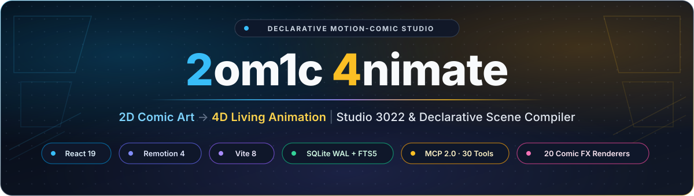
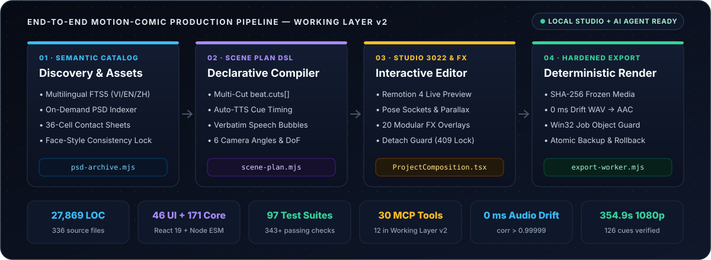
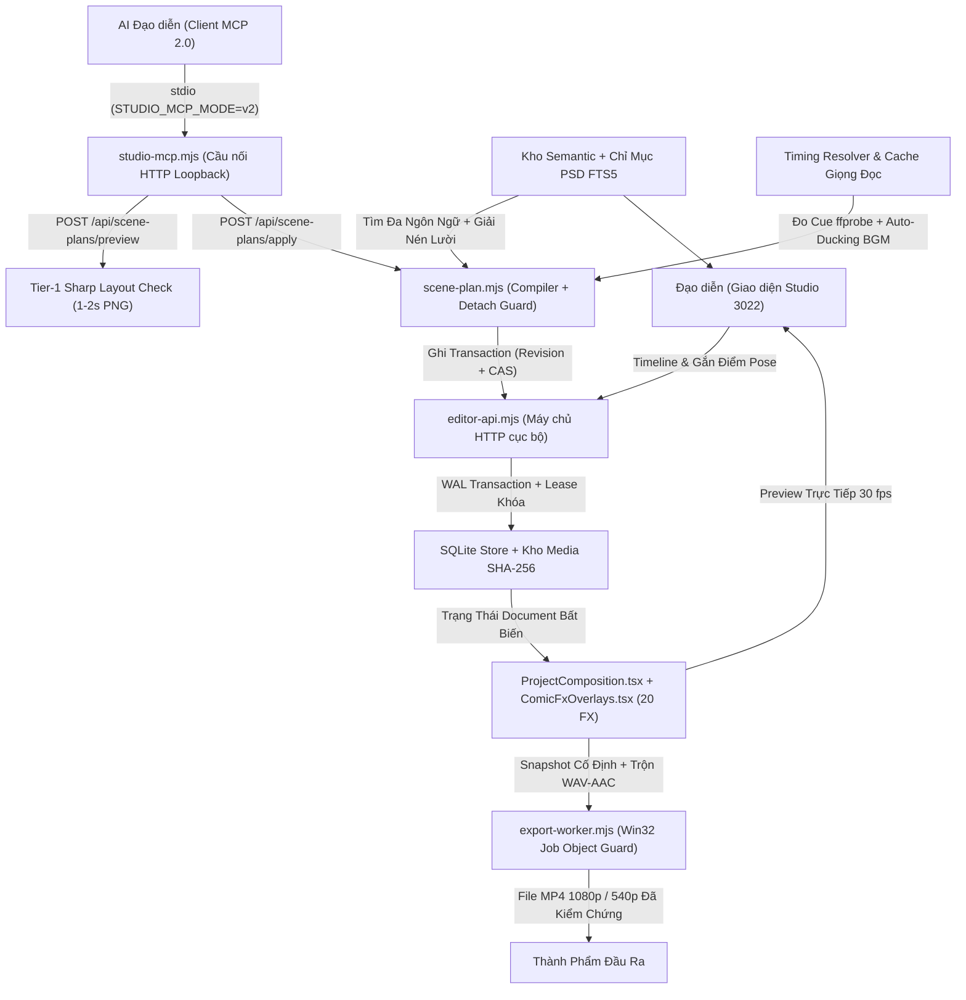

<div align="center">



<br />
<br />

[](https://react.dev/)
[](https://www.remotion.dev/)
[](https://vite.dev/)
[](https://nodejs.org/)
[](https://www.sqlite.org/)
[](story_workflow_ui/visual-editor/studio-mcp.mjs)
[](story_workflow_ui/package.json)

[English](README.md) &nbsp;|&nbsp; **Tiếng Việt**

</div>

> **2om1c 4nimate** (*2D Comic Art → 4D Living Animation*) là **studio dựng phim truyện tranh theo lời kể, trình biên dịch cảnh khai báo (Declarative Scene Compiler) và engine render Remotion bất biến**. Được xây dựng quanh **Studio 3022**, nền tảng cho phép cả Đạo diễn thao tác trực tiếp lẫn AI Agent kết nối qua **MCP 2.0** biến file PSD tách lớp và kịch bản thoại thành phim motion-comic có góc máy, biểu cảm và âm thanh đồng bộ tuyệt đối—dùng chung duy nhất một `ProjectComposition` từ preview tức thì tới xuất MP4 1080p.

---

## Tổng Quan Thành Quả & Thông Số Đã Kiểm Chứng

<div align="center">

</div>

### Quy Mô Mã Nguồn (Nhánh Công Khai `main`)

| Hạng Mục | Con Số Thực Tế | Chi Tiết Kiến Trúc |
| --- | ---: | --- |
| **Tổng Dòng Mã (LOC)** | **27,869 dòng** | Trải trên **336** file mã nguồn (`.tsx`, `.ts`, `.mjs`, `.js`, `.css`, `.py`) |
| **Component React 19 UI** | **46 module `.tsx`** | Timeline, đồ thị keyframe, Storyboard, Episode Builder, kho PSD & lớp FX Remotion |
| **Module Engine Node ESM** | **171 module `.mjs`** | Trình biên dịch cảnh, SQLite store, FTS5 search, bộ trộn WAV, lease/phục hồi, MCP server |
| **Bộ Kiểm Thử Tự Động** | **97 file `.test.mjs`** | **`343/343` test pass** trong `visual-editor` (`node --test`) + `status-core.test.mjs` |
| **Cầu Nối MCP 2.0** | **30 Công Cụ Agent** | Đầy đủ thao tác studio + chế độ gọn **12 công cụ** Working Layer v2 |
| **Bộ Render FX Mô-đun** | **20 Overlay Primitive** | `ComicFxOverlays.tsx` + `fx-presets.mjs`: máy quay, lọc màu ký ức, sấm sét, khung truyện |
| **Tài Liệu Kỹ Thuật** | **33 file `.md`** | Kiến trúc bất biến, nhật ký ổn định hóa, hợp đồng sản xuất & skill AI đạo diễn |

### Thành Tích Kỹ Thuật & Độ Bền Đã Đo Đạc

Mọi số liệu dưới đây được trích trực tiếp từ các lượt chạy kiểm thử lặp và mô phỏng sự cố trong [ACCEPTANCE.md](story_workflow_ui/visual-editor/ACCEPTANCE.md) và [STABILIZATION.md](story_workflow_ui/visual-editor/STABILIZATION.md) *(lưu ý: các benchmark này chứng minh độ ổn định kỹ thuật & đồng bộ, tách biệt với khâu chấm điểm nghệ thuật)*.

| Cổng Kỹ Thuật | Kết Quả Đã Đo | Giải Pháp Cốt Lõi |
| --- | --- | --- |
| **Đồng Bộ Thoại – Hình** | Sai lệch **0 ms** (`corr >= 0.99999`) clip ngắn / **<= 0.3125 ms** trên **126 cue** | Trộn toàn bộ cue thành WAV tuyến tính trước khi mux H.264 + AAC, triệt tiêu hoàn toàn độ trễ priming `42.7 ms` |
| **Xuất Phim Dài 1080p** | **354.9 giây (10,647 frame)**, `36` layer, `52.4 MB` MP4 | Xuất trọn bộ 3 scene dài liên tục, phát browser `1x` trơn tru và đối chiếu từng mốc biên cảnh |
| **Tối Ưu Clock Preview** | Khôi phục **29.84 – 30.12 fps** (từ `14–16 fps`) | Memo hóa `inputProps` trong `ProjectComposition.tsx`, xác minh qua `13` mốc tua đa cảnh |
| **Cách Ly Tiến Trình Render** | Thu hồi sạch **11/11 tiến trình con** khi worker sập | Win32 Job Object (`KILL_ON_JOB_CLOSE`) + nhận diện `PID + OS start time`, không để sót Chromium/FFmpeg mồ côi |
| **Bền Vững Dữ Liệu** | Khóa lease nguyên tử, **CAS revision**, nháp từng cửa sổ | Khóa thư mục `data.lease/owner.json`, SQLite `WAL` + `BEGIN IMMEDIATE`, sao lưu online SHA-256 & nhật ký rollback |
| **UX Bàn Phím & Tương Phản** | Độ tương phản CTA **3.964 → 5.394**; **`1+1` tabstop** | Nén điều hướng `146 face + 104 pose` bằng lưới phím mũi tên và cô lập tầng xếp lớp modal |

---

## Điểm Nhấn Kỹ Thuật Nổi Bật

### 1. Trình Biên Dịch Cảnh Khai Báo (`Working Layer v2`)

Thay vì chỉnh tay từng tọa độ pixel cho hàng chục shot, [`scene-plan.mjs`](story_workflow_ui/visual-editor/scene-plan.mjs) biên dịch kịch bản cảnh dạng JSON thành toàn bộ cây layer, keyframe chuyển động, góc máy, nhạc nền tự nhỏ tiếng và bong bóng thoại:

- **Lấy Thời Lượng Từ Giọng Đọc Thật (`timing-resolver.mjs`)**: Chế độ `auto-tts` tự đo từng cue thoại bằng `ffprobe`, lưu cache audio bất biến theo SHA-256 và cộng khoảng đệm tự nhiên; chế độ `draft` cho phép lên khung nháp không cần audio.
- **Chia Nhịp Chuyển Cảnh Chống Đứng Hình (`beat.cuts[]`)**: Tự động chẻ các câu thoại dài thành nhiều nhịp hình liên tiếp theo tỷ lệ mệnh đề (`ratio`), đảm bảo không một khung hình nào đứng im quá 3 giây.
- **Bám Nguyên Văn Thoại & Bong Bóng Chỉ Miệng (`fx-presets.mjs`)**: Các hàm `extractQuotedDialogueSegments()`, `locateQuoteSpan()`, `splitSpeechChunks()`, `allocateChunkSpans()` khớp từng đoạn thoại `"..."` theo nhịp nói, chống rớt từ nối tiếng Việt khi xuống dòng và chĩa đuôi bong bóng đúng miệng nhân vật nói (`speaker` / `speech.prop`).
- **Đạo Diễn Thông Minh & Giữ Sân Khấu Liên Tục**: Tự động cắt cận đầu–vai (`portrait`) khi `shot: "close"`, làm mờ hậu cảnh + nhân vật phụ theo `focus` (`DofStyleOverlay`), tự xoay mặt đối thoại (`faceTo` / `look`), chống đè chéo X và giữ vị trí nhân vật xuyên suốt bối cảnh (`persistStage: true`).
- **Lá Chắn Bảo Vệ Sửa Tay (`Detach Guard`)**: Cảnh sinh từ JSON có trạng thái `plan-managed`. Ngay khi Đạo diễn chỉnh tay trên giao diện Studio 3022, cảnh chuyển sang `detached`—mọi lệnh ghi đè từ compiler sẽ bị chặn an toàn với mã `409 SCENE_DETACHED` trừ khi truyền rõ `forceResync: true`.

<details>
<summary><b>Xem Ví Dụ JSON Scene Plan (Cảnh Hồi Ức Đa Nhịp + Đồng Bộ Thoại)</b></summary>

```json
{
  "version": 1,
  "id": "demo-courtyard-flashback",
  "title": "Ký ức hoàng hôn ngoài sân",
  "persistStage": true,
  "timing": { "mode": "auto-tts", "padFrames": 12, "fps": 30 },
  "captionStyle": "highlight",
  "bgm": { "preset": "story", "volume": 0.24, "duckVolume": 0.08 },
  "location": { "asset": "Sân cổ hoàng hôn" },
  "cast": {
    "hero":   { "asset": "Nhân vật chính", "faceStyle": "detailed" },
    "mentor": { "asset": "Sư phụ",         "faceStyle": "detailed" }
  },
  "beats": [
    {
      "id": "b1",
      "quote": "Dưới ánh nắng cuối chiều, người thầy khẽ ngoảnh lại: \"Đừng bao giờ nhầm sự kiên nhẫn với yếu đuối.\"",
      "mood": "flashback",
      "lighting": "sunset",
      "cuts": [
        {
          "ratio": 0.42,
          "shot": "wide",
          "camera": "drift",
          "focus": ["hero", "mentor"],
          "actors": [
            { "who": "hero",   "pose": "stand", "face": "calm",  "at": "left",  "faceTo": "mentor" },
            { "who": "mentor", "pose": "arms-crossed", "face": "warm", "at": "right", "faceTo": "hero" }
          ]
        },
        {
          "ratio": 0.58,
          "shot": "close",
          "angle": "ots",
          "camera": "push-in",
          "speaker": "mentor",
          "speech": { "who": "mentor", "fromQuote": true, "variant": "normal" },
          "actors": [
            { "who": "mentor", "pose": "point-wise", "face": "serious", "at": "keep", "speaking": true },
            { "who": "hero",   "pose": "listen",     "face": "focused", "at": "keep", "emote": "spark" }
          ]
        }
      ]
    }
  ]
}
```

</details>

---

### 2. Hệ Thống Hiệu Ứng Truyện Tranh & Bộ Lọc Ký Ức Chuẩn CapCut

Được triển khai trong [`ComicFxOverlays.tsx`](story_workflow_ui/visual-editor/ComicFxOverlays.tsx) và [`fx-presets.mjs`](story_workflow_ui/visual-editor/fx-presets.mjs), **20 bộ render FX mô-đun thuần SVG/CSS** hoạt động đồng bộ từ frame `0` (không trễ Canvas) trên cả preview và file xuất MP4:

| Nhóm Hiệu Ứng | Số Lượng | Các Preset & Tính Năng Sẵn Có |
| --- | :---: | --- |
| **Bộ Lọc Tâm Trạng & Hồi Ức CapCut** | **6** | `flashback` (phim sepia vàng ấm hoài niệm, vệt cháy sáng mép khung, hạt nhiễu & xước phim), `flashback-cold` (tông xám xanh lạnh cô lập/tổn thương, độ tương phản cao, viền tối đậm), `tension`, `danger`, `action`, `system` |
| **Chuyển Động Máy Quay & Góc Máy** | **9 + 6** | **Camera**: `off`, `push-in`, `pull-out`, `pan-left`, `pan-right`, `drift`, `zoom-punch`, `whip-left`, `whip-right` · **Góc máy**: `standard`, `reverse`, `ots` (qua vai), `hero-low`, `dutch-left/right` |
| **Chuyển Động Nhân Vật & Đạo Cụ** | **14 + 6** | **Nhân vật**: `dash-left/right`, `step-in`, `recoil`, `run-left/right`, `slide-in-left/right`, `bob`, `breathe`, `float`, `talk`, `talk-excited` + dư ảnh `trail` · **Đạo cụ**: `throw-left/right`, `arc`, `float`, `spin` |
| **Hạt Môi Trường & Ánh Sáng** | **7 + 5** | **Hạt**: `dust`, `sparks`, `embers`, `wind`, `debris`, `smoke`, `rain` · **Ánh sáng**: `sunset`, `night`, `alarm`, `spotlight`, `point` |
| **Va Chạm Manga, Khung Thoại & Âm Thanh** | **20+FX** | `impactFrame` (`invert`, `bw`, `crimson`), `cutTransition` (`glitch-slam`, `diagonal-wipe`, `energy-burst`, `shutter`), `splitPanel` (chia khung đối đầu), `aura` (4 hệ), `emote` (6 biểu tượng), `sfxText` (5 kiểu chữ động), khung vẽ tay double-ink (`sketchyRectPaths`), `filmBurn`, `halftone`, `portalGlow`, `dof`, `silhouette`, `letterbox`, cùng 7 `bgm` auto-ducking & 3 `sfx` |

---

### 3. Studio 3022 Visual Editor & Gắn Điểm Cầm Theo Pose

Môi trường dựng hình trực quan chạy cục bộ trên nền React 19 + Remotion 4 ([`App.tsx`](story_workflow_ui/visual-editor/App.tsx), [`ARCHITECTURE.md`](story_workflow_ui/visual-editor/ARCHITECTURE.md)):

- **Timeline Hai Chế Độ**: Chuyển mượt giữa **Toàn phim** (xem liên tục toàn tập, kéo sắp xếp thứ tự cảnh) và **Scene đang sửa** (đặt mốc keyframe X/Y/easing, trim độ dài layer, phím tắt `K`).
- **Điểm Cầm Theo Pose & Tái Sử Dụng Bộ ([`ASSEMBLIES.md`](story_workflow_ui/visual-editor/ASSEMBLIES.md))**: Gắn vũ khí/đạo cụ vào tay trái, tay phải hoặc thắt lưng theo từng pose; tự động xoay/lật theo nhân vật cha, khóa chống trôi khi đổi pose và lưu thành bộ tái sử dụng trong SQLite.
- **Phối Cảnh Nhiều Lớp Parallax ([`ParallaxPanel.tsx`](story_workflow_ui/visual-editor/ParallaxPanel.tsx))**: Tách biệt thứ tự che Z (`0` cho nền tới `10000` cho phụ đề) với độ gần parallax (`0` chân trời → `2.0` tiền cảnh).
- **Trình Xây Tập Phim & Storyboard ([`EpisodeBuilder.tsx`](story_workflow_ui/visual-editor/EpisodeBuilder.tsx), [`Storyboard.tsx`](story_workflow_ui/visual-editor/Storyboard.tsx))**: Tách kịch bản từng đoạn, theo dõi tiến độ TTS, áp bộ nhân vật nhanh và nhảy thẳng tới frame cần sửa.

---

### 4. Kho PSD Chỉ Mục FTS5 Không Giải Nén Trước & Tìm Kiếm Đa Ngôn Ngữ

- **Chỉ Mục Tức Thì Bằng SQLite FTS5 ([`psd-archive.mjs`](story_workflow_ui/visual-editor/psd-archive.mjs))**: Quét và lập chỉ mục hàng nghìn file `.psd` thô với chuẩn hóa dấu (`unicode61 remove_diacritics 2`) cùng từ điển đồng nghĩa **Việt / Anh / Trung**, không giải nén hàng loạt gây tốn ổ cứng.
- **Xem Trước Trước Khi Trích Xuất**: Render thumbnail `640px`, xem **contact sheet đánh số 36 ô**, thử ghép trực tiếp **pose × khuôn mặt**, rồi mới giải nén từng file PSD được chọn qua [`scripts/extract-one-psd.py`](story_workflow_ui/visual-editor/scripts/extract-one-psd.py) và lưu bất biến theo mã băm SHA-256.

---

### 5. Cầu Nối MCP 2.0 & Quy Trình Đa Agent An Toàn

[`studio-mcp.mjs`](story_workflow_ui/visual-editor/studio-mcp.mjs) mở giao diện chuẩn MCP 2.0 qua stdio (`STUDIO_MCP_MODE=full` = **30 tool**, `STUDIO_MCP_MODE=v2` = **12 tool cốt lõi**), chỉ giao tiếp qua HTTP loopback để AI cùng dựng phim với con người:

- **Kiểm Tra Hình Ảnh 2 Tầng**: `scene_plan_preview` xuất ảnh kiểm bố cục **Tier-1 bằng Sharp** trong ~1–2 giây (đóng dấu `NOT FOR REVIEW`, chưa ghi DB) để soát hướng nhìn & chân đứng; `studio_preview_capture` + `studio_capture_image` chụp ảnh **Tier-2 Remotion thật** kèm đối chiếu SHA-256 mã nguồn và media.
- **Phân Tách Quyền Hạn Chặt Chẽ**: Agent không đọc/ghi thẳng SQLite, bị chặn trên cảnh đã duyệt (`lockedPrefix`) hoặc cảnh Đạo diễn đã sửa tay (`detached`), và không tự cấp quyền xuất video cuối ([`export-owner-console.mjs`](story_workflow_ui/visual-editor/export-owner-console.mjs)).

<details>
<summary><b>Danh Sách 12 Công Cụ MCP Cốt Lõi (Chế Độ <code>STUDIO_MCP_MODE=v2</code>)</b></summary>

| Tên Tool MCP | Nhiệm Vụ Trong Quy Trình | Chỉ Đọc |
| --- | --- | :---: |
| `studio_state` | Đọc revision dự án/scene, `planState`, `lockedPrefix` & trạng thái cổng sản xuất | Có |
| `studio_catalog_search` | Tìm kiếm đa ngôn ngữ FTS5 (Việt/Anh/Trung) nhân vật, pose, đạo cụ & bối cảnh | Có |
| `studio_asset_sheet` | Lấy tờ ảnh đối chiếu 36 ô đánh số (`bean` / `detailed`) | Có |
| `psd_archive_search` | Tìm trong kho PSD gốc mà chưa cần giải nén | Có |
| `psd_archive_thumb` | Xem trước ảnh composite 640px của một file PSD ứng viên | Có |
| `psd_archive_extract` | Trích xuất lười một PSD được chọn vào catalog đã xác minh | Không |
| `scene_plan_preview` | Biên dịch JSON + render kiểm bố cục nhanh Tier-1 Sharp (chưa ghi SQLite) | Có |
| `scene_plan_apply` | Đo cue (`auto-tts`/`draft`), chuẩn bị media SHA-256 & lưu có Detach Guard | Không |
| `studio_scene_read` | Đọc toàn bộ document & danh sách cue đã lưu của một scene | Có |
| `studio_preview_capture` | Chụp khung hình Remotion thật từ server cho đúng revision đang lưu | Không |
| `studio_capture_image` | Tải ảnh bằng chứng Tier-2 đã băm kiểm chứng (từ chối khi mã/media thay đổi) | Có |
| `studio_export_request` | Gửi hoặc kiểm tra lại mã xuất video MP4 (`1080p` / `540p`) | Không |

</details>

---

## Sơ Đồ Kiến Trúc Hệ Thống



---

## Cấu Trúc Kho Mã Nguồn

```text
2om1c-4nimate/
├── docs/assets/                   # Đồ họa vector giới thiệu tương thích GitHub
├── story_workflow_ui/
│   ├── visual-editor/             # Lõi Studio 3022, UI React 19, Remotion FX & 96 bộ test
│   │   ├── scene-plan.mjs         # Trình biên dịch Working Layer v2 + Detach Guard
│   │   ├── fx-presets.mjs         # Kho preset máy quay, chuyển động, bộ lọc hồi ức CapCut & SFX
│   │   ├── ComicFxOverlays.tsx    # 20 bộ render hiệu ứng truyện tranh SVG/CSS thuần
│   │   ├── ProjectComposition.tsx # Composition dùng chung cho Preview & Xuất MP4
│   │   ├── studio-mcp.mjs         # Máy chủ MCP 2.0 (30 tool / 12 tool v2)
│   │   ├── psd-archive.mjs        # Chỉ mục PSD SQLite FTS5 & trích xuất theo nhu cầu
│   │   ├── project-store.mjs      # Lưu trữ SQLite transaction, CAS revision & lịch sử sửa
│   │   ├── export-worker.mjs      # Worker render MP4 cô lập + bảo vệ tiến trình Job Object
│   │   ├── App.tsx                # Không gian dựng phim, timeline & bảng thông số
│   │   └── *.test.mjs             # 96 bộ kiểm thử tự động (unit, tích hợp, mô phỏng lỗi)
│   ├── backend/                   # Cấu hình & mô hình lập kế hoạch sản xuất (đã tách provider riêng)
│   ├── frontend/js/               # Hàm bổ trợ chuyển động & kiểm tra luồng dựng
│   └── docs/                      # Tài liệu luồng dựng & vận hành
├── video-system/                  # CLI kiểm trạng thái (status.mjs) & tài liệu quy trình
├── creative-memory/               # Sổ tay hướng dẫn phong cách sáng tạo
├── .agents/                       # Bộ skill cho AI đạo diễn (studio-storytelling, create-scene, review-scene)
└── motion_intro/                  # Lockfile phụ thuộc lõi Remotion / Babel
```

---

## Cài Đặt & Chạy Nhanh

### Yêu Cầu Hệ Thống
- **Node.js** `>= 22.19 < 23` *(sử dụng `node:sqlite` `DatabaseSync` tích hợp sẵn)*
- **FFmpeg & ffprobe** có trong `PATH` *(hoặc đặt `FFMPEG_PATH` / `FFPROBE_PATH`)*
- **Python 3** *(tùy chọn, chỉ cần khi dùng tính năng trích xuất từng layer PSD)*

### 1. Cài Đặt Thư Viện
```powershell
cd motion_intro
npm install

cd ..\story_workflow_ui
npm install
```

### 2. Chạy Kiểm Thử & Kiểm Tra TypeScript
Chạy trong thư mục tạm và cổng ngẫu nhiên—hoàn toàn độc lập, không đụng dữ liệu đang dựng:
```powershell
cd story_workflow_ui
npm run video:edit:check
```

### 3. Build & Mở Studio 3022
```powershell
cd story_workflow_ui
node visual-editor/launch-editor.mjs
```
Sau khi khởi động, truy cập `http://127.0.0.1:3022` trên trình duyệt.

### 4. Sao Lưu & Phục Hồi Dữ Liệu
```powershell
cd story_workflow_ui
node visual-editor/backup-cli.mjs create
node visual-editor/backup-cli.mjs list
# Đóng editor sạch trước khi phục hồi:
node visual-editor/backup-cli.mjs restore --id=<ma-ban-sao>
# Hoặc mở giao diện phục hồi offline tại http://127.0.0.1:3024:
node visual-editor/recovery-server.mjs
```

---

## Tài Liệu Chuyên Sâu

| Tài Liệu | Nội Dung Chính |
| --- | --- |
| [ARCHITECTURE.md](story_workflow_ui/visual-editor/ARCHITECTURE.md) | Ranh giới module, bất biến lưu trữ SQLite và nguyên tắc mở rộng |
| [SCENE-PLAN.md](story_workflow_ui/visual-editor/SCENE-PLAN.md) | Đặc tả đầy đủ JSON Scene Plan, preset máy quay, hiệu ứng & Detach Guard |
| [ASSEMBLIES.md](story_workflow_ui/visual-editor/ASSEMBLIES.md) | Nhóm cha–con theo điểm cầm pose, parallax đa lớp & cây timeline |
| [EPISODE-BUILDER.md](story_workflow_ui/visual-editor/EPISODE-BUILDER.md) | Luồng tách kịch bản dựng tập, phục hồi nháp & xử lý xung đột phiên bản |
| [ACCEPTANCE.md](story_workflow_ui/visual-editor/ACCEPTANCE.md) | Bảng đối chiếu 8 cổng kiểm chứng kỹ thuật & giới hạn đo đạc |
| [SCRIPT-PLANS.md](story_workflow_ui/visual-editor/SCRIPT-PLANS.md) | Giao thức AI qua MCP, kiểm băm AST & phân tách quyền xuất video |
| [STUDIO-INTEGRATION.md](video-system/STUDIO-INTEGRATION.md) | Bản đồ tích hợp các hệ thống con trong Studio |
| [studio-storytelling/SKILL.md](.agents/skills/studio-storytelling/SKILL.md) | Sổ tay đạo diễn & quy tắc kể chuyện bằng hình cho AI Agent |

---

<details>
<summary><b>Phạm Vi Kho Mã Công Khai & Bảo Mật Dữ Liệu</b></summary>

Nhánh công khai trên GitHub chỉ chứa **bộ công cụ studio, trình biên dịch cảnh, bộ render React/Remotion và hệ thống kiểm thử dùng lại**. Các API provider bên thứ ba, cơ sở dữ liệu SQLite (`*.sqlite*`), file cấu hình bí mật, adapter cục bộ (`*.local.*`), kịch bản và kho vật liệu/tài nguyên riêng đều được loại trừ an toàn qua [`.gitignore`](.gitignore). Người dùng có thể tự gắn provider riêng qua biến môi trường hoặc file `*.local.*` mà không cần sửa lõi engine.

</details>
